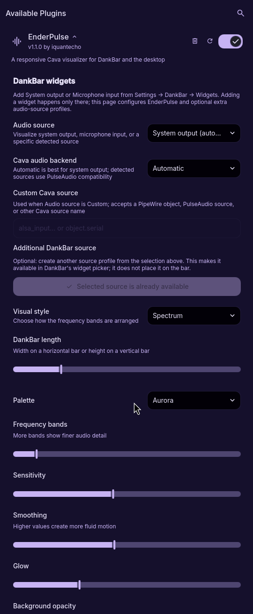

# EnderPulse

EnderPulse is a responsive, theme-aware audio visualizer for
[Dux Shell](https://github.com/duxlabs-dev/dux-shell). It works
as a compact bar or dock widget and a resizable desktop widget. Cava's live
frequency data can be rendered as Unicode Braille, a spectrum, a mirrored
pulse, or a radial orbit without modifying DMS itself.


## Why we made it

EnderPulse started because we wanted a balanced, glanceable DankBar: system
output moving on the left side of the centre and microphone input moving on the
right. One side shows what the computer is playing while the other shows what
the microphone is hearing. It grew from that idea into a flexible visualizer
for other bar layouts and the desktop too.

## Visual styles


<p align="center">
  
  
</p>

The screenshots above were captured from DMS 1.5.3 while audio was playing
through the desktop's normal audio graph.

## Features

- Dux 2 support for horizontal and vertical bars and docks
- Unicode Braille, spectrum, mirrored pulse, and radial orbit render modes
- System-output, default-microphone, detected-source, and custom-source capture
- Stable microphone scaling with a lightweight gate for low ambient input
- Material theme, aurora, ember, and monochrome palettes
- Adjustable band count, sensitivity, smoothing, glow, and background opacity
- Automatic fade after playback stops
- Rendering capped near 30 FPS and suspended after silence; capture stops while hidden
- Adjustable DankBar length and normal desktop-widget resizing
- Dependency check with a clear message when `cava` is unavailable
- Bounded process recovery instead of an unbounded restart loop

## Requirements

- Dux Shell 2.0.0 or newer (older DMS installations should keep EnderPulse 1.1.0)
- [Cava](https://github.com/karlstav/cava)
- A working PipeWire or PulseAudio audio source supported by Cava

## Install

Install EnderPulse from the Dank plugin registry:

```bash
dms plugins install enderPulse
```

For a manual installation:

```bash
git clone https://github.com/iquantecho/enderpulse.git \
  ~/.config/dms/plugins/enderPulse
dms restart
```

Open **Settings → Plugins** and enable EnderPulse. Add it to DankBar from the
bar's widget list or the dock editor, add it to the desktop from the desktop widget browser, or
use both surfaces. Its appearance and audio-source controls are available in
the plugin settings. Clicking a bar visualizer opens EnderPulse's own settings page; hovering has no action,
including when the bar's Hover popouts option is enabled.

## Configuration

EnderPulse provides source, backend, visual-style, size, palette,
frequency-band, sensitivity, smoothing, glow, and background controls. Plugin
settings also let you create additional source profiles for DankBar's widget
picker.

<p align="center">
  
</p>

## Audio sources

**System output (automatic)** follows Cava's default output monitor. **Default
microphone** records the current PulseAudio/PipeWire-Pulse input. When `pactl`
is available, EnderPulse also lists every detected input and output-monitor
source in its settings.

To show output and microphone activity side by side, add the built-in
**EnderPulse - System output** and **EnderPulse - Microphone input** entries
from DankBar's widget picker. Widget placement happens only in DankBar settings.
EnderPulse's plugin settings manage shared appearance and optional profiles for
additional detected or custom sources. The default source applies to the desktop/default
widget. Built-in output and microphone widgets retain their own sources; appearance
settings are shared unless a saved source profile overrides them. Backend and custom
source fields appear only when relevant. Use **Refresh audio devices** after connecting
a device; detected devices use readable names while retaining their stable source IDs.

For a native PipeWire object or another Cava backend, choose **Custom Cava
source**, select the matching backend, and enter the source identifier. For
PipeWire this can be an `object.path`, `object.serial`, or an output object's
name with `.monitor` appended.

## Troubleshooting

- **No movement:** play audio, verify that `cava` works in a terminal, and try
  selecting the source explicitly in EnderPulse settings.
- **Plugin is blocked:** install Cava using your distribution's package manager,
  then disable and re-enable EnderPulse.
- **Settings do not appear:** EnderPulse 1.2 requires Dux 2.0.0 or newer.
- **A device is missing from the list:** install `pactl` (usually provided by
  `libpulse` or `pipewire-pulse`) or enter its Cava source identifier manually.
- **Audio unavailable:** check the selected source and audio server, then reload the
  plugin. Capture retries three times before stopping; changing a capture setting also
  resets the retry budget. Cache write or permission errors prevent capture from starting.

## Development

Run the repository checks with:

```bash
./scripts/validate.sh
```

The script runs structured manifest and registry checks plus executable tests
against the JavaScript frame parser used by QML. It also runs `qmllint` when
available. Runtime acceptance is performed in a real DMS session because the
plugin depends on DMS-injected QML services and an active audio graph.

Set `NODE=/path/to/node` if Node is not on your PATH. On a machine with Quickshell,
Cava, and a running user audio server, also run `./scripts/test-capture.sh`. It tests
real capture, hiding/showing with unchanged and changed settings, bounded failure,
and recovery. It does not save audio.

For ordinary edits, use `dms ipc call plugins reload enderPulse`. Dux 2.0's reload
revisions top-level components but can retain imported QML/JavaScript dependencies.
After changing those dependencies, a managed `dms restart` is required to test a fresh
load; finish any screen recording or capture first.

## Licence

EnderPulse is released under the [MIT Licence](LICENSE). DMS and Cava are also
MIT-licensed. EnderPulse invokes the separately installed Cava executable and
does not bundle either project's source or binaries.
