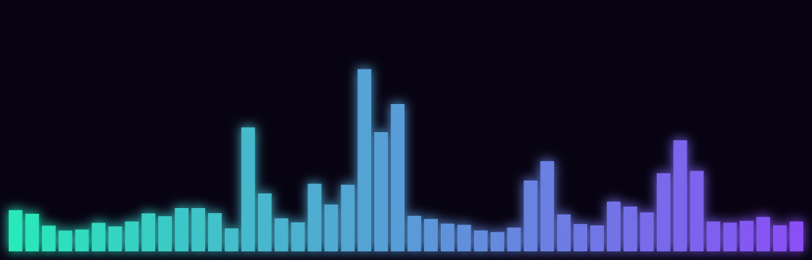
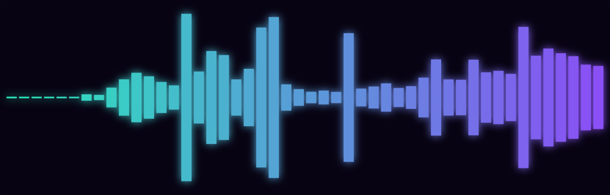

# EnderPulse

EnderPulse is a responsive, theme-aware audio visualizer for
[DankMaterialShell](https://github.com/AvengeMedia/DankMaterialShell). It works
as both a compact DankBar widget and a resizable desktop widget. Cava's live
frequency data can be rendered as Unicode Braille, a spectrum, a mirrored
pulse, or a radial orbit without modifying DMS itself.



<p align="center">
  
  
</p>

The screenshots above were captured from DMS 1.5.3 while audio was playing
through the desktop's normal audio graph.

## Features

- DankBar support for horizontal and vertical panels
- Unicode Braille, spectrum, mirrored pulse, and radial orbit render modes
- System-output, default-microphone, detected-source, and custom-source capture
- Stable microphone scaling with a lightweight gate for low ambient input
- Material theme, aurora, ember, and monochrome palettes
- Adjustable band count, sensitivity, smoothing, glow, and background opacity
- Automatic fade after playback stops
- Rendering capped near 30 FPS, with work suspended while hidden or silent
- Adjustable DankBar length and normal desktop-widget resizing
- Dependency check with a clear message when `cava` is unavailable
- Bounded process recovery instead of an unbounded restart loop

## Requirements

- DankMaterialShell 1.5.1 or newer
- [Cava](https://github.com/karlstav/cava)
- A working PipeWire or PulseAudio audio source supported by Cava

## Install

Once EnderPulse is listed in the Dank Linux plugin registry:

```bash
dms plugins install enderPulse
```

For a manual installation:

```bash
git clone https://github.com/iquantecho/enderpulse.git \
  ~/.config/DankMaterialShell/plugins/enderPulse
dms restart
```

Open **Settings → Plugins** and enable EnderPulse. Add it to DankBar from the
bar's widget list, add it to the desktop from the desktop widget browser, or
use both surfaces. Its appearance and audio-source controls are available in
the plugin settings.

## Audio sources

**System output (automatic)** follows Cava's default output monitor. **Default
microphone** records the current PulseAudio/PipeWire-Pulse input. When `pactl`
is available, EnderPulse also lists every detected input and output-monitor
source in its settings.

To show output and microphone activity side by side, add the built-in
**EnderPulse - System output** and **EnderPulse - Microphone input** entries
from DankBar's widget picker. Widget placement happens only in DankBar settings.
EnderPulse's plugin settings manage shared appearance and optional profiles for
additional detected or custom sources.

For a native PipeWire object or another Cava backend, choose **Custom Cava
source**, select the matching backend, and enter the source identifier. For
PipeWire this can be an `object.path`, `object.serial`, or an output object's
name with `.monitor` appended.

## Troubleshooting

- **No movement:** play audio, verify that `cava` works in a terminal, and try
  selecting the source explicitly in EnderPulse settings.
- **Plugin is blocked:** install Cava using your distribution's package manager,
  then disable and re-enable EnderPulse.
- **Settings do not appear:** EnderPulse requires DMS 1.5.1 or newer.
- **A device is missing from the list:** install `pactl` (usually provided by
  `libpulse` or `pipewire-pulse`) or enter its Cava source identifier manually.

## Development

Run the repository checks with:

```bash
./scripts/validate.sh
```

The script runs structured manifest and registry checks plus executable tests
against the JavaScript frame parser used by QML. It also runs `qmllint` when
available. Runtime acceptance is performed in a real DMS session because the
plugin depends on DMS-injected QML services and an active audio graph.

## Licence

EnderPulse is released under the [MIT Licence](LICENSE). DMS and Cava are also
MIT-licensed. EnderPulse invokes the separately installed Cava executable and
does not bundle either project's source or binaries.
